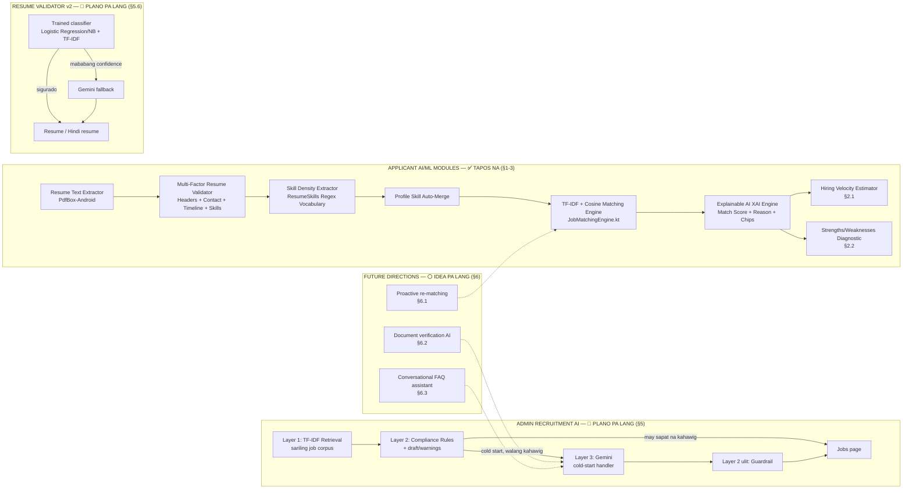
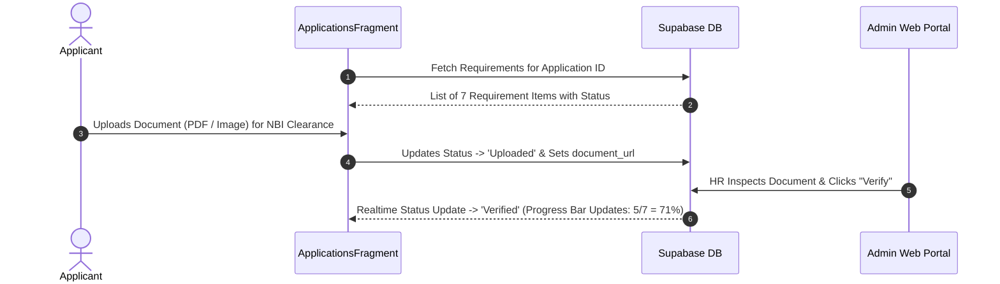

# MR.D.I.Y. Careers — Advanced AI/ML & Pre-Employment Planning Specification

This document provides a comprehensive engineering blueprint for advanced AI/ML features, pre-employment onboarding workflows, hiring velocity estimation, candidate strengths/weaknesses diagnostics, explainable AI ranking, and AI job description generation for the HR Admin portal.

---

## Architecture Overview

Status legend: ✅ tapos na (Section 1-3) · 🔵 PLANO PA LANG, may phases na (Section 5, 5.6) · ⚪ idea pa lang, walang code (Section 6.1-6.3) · ⚠️ superseded (Section 4)



---

## Section 1: Pre-Employment Steps & Onboarding Checklist Workflow

### 1.1 Objective
Provide an interactive pre-employment onboarding workflow for candidates who reach the "Shortlisted" or "Hired" stage, guiding them through required pre-employment documents and government compliance steps before day 1 of work.

### 1.2 Requirements Checklist
- SSS Number / E-1 Form
- PhilHealth Member Data Record (MDR)
- Pag-IBIG MID Number / Member Data Form
- NBI Clearance / Police Clearance
- Pre-Employment Medical Exam / Health Permit
- BIR Form 1902 / TIN
- Signed Employment Contract

### 1.3 Data Schema (Supabase PostgreSQL)
Table Name: `public.pre_employment_requirements`
- `id` (UUID, Primary Key, default `gen_random_uuid()`)
- `user_id` (TEXT, Foreign Key -> `profiles.user_id`)
- `application_id` (UUID, Foreign Key -> `applications.id`)
- `requirement_name` (TEXT, e.g., 'NBI Clearance')
- `status` (TEXT: 'Pending', 'Uploaded', 'Verified', 'Rejected')
- `document_url` (TEXT)
- `updated_at` (TIMESTAMPTZ, default `now()`)

### 1.4 Workflow Sequence


---

## Section 2: Hiring Velocity Estimator & Strengths/Weaknesses ML Diagnostic

### 2.1 Hiring Velocity Estimator Algorithm
Predicts estimated turnaround days from application submission to official job offer.

$$\text{Estimated Days} = \text{Base Timeline (7 Days)} + \Delta_{\text{Match}} + \Delta_{\text{Profile}} + \Delta_{\text{Docs}} + \Delta_{\text{Gaps}}$$

- **Base Hiring Timeline:** 7 Business Days
- **Score Adjustments ($\Delta$):**
  - Match Score $\ge 85\%$: $-2$ Days (High urgency priority hire)
  - Complete Profile & Uploaded Resume: $-1$ Day
  - Complete Pre-Employment Documents: $-1$ Day
  - Lacks core skills ($< 50\%$ match): $+3$ Days
  - Experience Level Mismatch: $+2$ Days
- **Output Format:** `"Estimated Hiring Velocity: 2 - 4 Business Days"`

### 2.2 Strengths and Weaknesses ML Diagnostic Engine
Class Name: `CandidateDiagnosticEngine.kt`

#### A. Strengths (Mga Kasanayan at Bentahe):
- Core Skill Matches: Matches between candidate skills and job requirements.
- Experience Fit: Candidate years of experience vs required level.
- Geographic Fit: Lives within Metro Manila branch boundary (`LocationDistance.kt`).
- Example Outputs:
  - `[+]` *"Strong Cash Handling & POS expertise (3+ years)"*
  - `[+]` *"High TF-IDF similarity in Store Management & Inventory Auditing"*
  - `[+]` *"Location match: Pasig City (Branch Proximity ~4.2 km)"*

#### B. Weaknesses / Skill Gaps (Mga Kulang na Kasanayan):
- Missing Core Skills: Key requirements listed in job description missing from candidate profile.
- Missing Certifications: e.g., Forklift license, First Aid certification.
- Example Outputs:
  - `[-]` *"Lacks listed requirement: Forklift Operation Certification"*
  - `[-]` *"No prior experience listed in Visual Merchandising"*

---

## Section 3: Explainable AI (XAI) Ranking Explanation Engine

### 3.1 Objective
Provide transparent, human-readable explanations detailing WHY a candidate was ranked at a specific position and match percentage, eliminating black-box AI mistrust.

### 3.2 Mathematical Model (TF-IDF & Cosine Similarity)

Term Frequency - Inverse Document Frequency (TF-IDF):

$$\text{TF}(t, d) = \frac{f_{t,d}}{\sum_{t' \in d} f_{t',d}}$$

$$\text{IDF}(t, D) = \ln\left( \frac{|D|}{1 + |\{d \in D : t \in d\}|} \right)$$

$$\text{TF-IDF}(t, d, D) = \text{TF}(t, d) \times \text{IDF}(t, D)$$

Cosine Similarity Equation:

$$\text{Cosine Similarity}(\vec{A}, \vec{B}) = \frac{\vec{A} \cdot \vec{B}}{\|\vec{A}\| \|\vec{B}\|} = \frac{\sum_{i=1}^{n} A_i B_i}{\sqrt{\sum_{i=1}^{n} A_i^2} \sqrt{\sum_{i=1}^{n} B_i^2}}$$

### 3.3 XAI Explanation Template Output
> *"Candidate [Name] is ranked at #[Rank] with a [Score]% Match for [Job Title]. This ranking is driven by a [Similarity]% text similarity in [Category] roles, matching [MatchedCount] out of [TotalReqs] primary job requirements ([SkillsList]). Candidate experience of [Years] years aligns with the [Level] requirement."*

---

## Section 4: AI Job Description Generator for Admin Web Portal — ⚠️ SUPERSEDED, see Section 5

Ang ideya dito (template-based lang, walang ML) ay **pinalitan ng Layered AI Job Description Generator sa Section 5**, na may sariling TF-IDF retrieval + rules bilang core, at Gemini bilang cold-start handler. Iniiwan lang ito dito bilang record ng orihinal na mungkahi.

### 4.1 Objective
Assist HR Administrators when creating or editing job postings in the Admin Web Portal (`mrdiy-admin`) by automatically generating optimized, retail-ready job descriptions based on the specified job title.

### 4.2 UI & Functionality
- **UI Button:** `✨ Generate AI Description` button next to Description field in `mrdiy-admin/app/jobs/page.tsx`.
- **Input:** Job Title (e.g., *"Store Supervisor"*, *"Warehouse Crew"*, *"Cashier"*, *"HR Officer"*).
- **Template Output Structure:**
  - About the Role
  - Key Responsibilities
  - Requirements
  - Benefits

---

## Section 5: Layered AI Job Description Generator — PLANO PA LANG (2026-10-14)

Pinapalitan nito ang paraan sa Section 4 (template-based, walang ML).

**Loose end na in-ayos (2026-10-15):** una naming naisip na gawing trained classifier ito gamit ang 24-category na Kaggle resume dataset (HR, Sales, IT, Aviation, Advocate, Agriculture...). **Tinanggal ang ideyang 'yon** — lumabas ito sa scope, dahil karamihan sa 24 categories ay walang kinalaman sa mga totoong posisyon ng MR.DIY (Cashier, Stock Clerk, Store Manager, atbp.). Ang Resume Validator (§5.6) na lang ang magiging trained-model feature, hindi ang JD Generator.

### 5.1 Patakaran (capstone constraint)

- **Bawal ang "plain AI API lang."** Ang title ng study ay *"A Mobile-Based Recruitment System Using Machine Learning For Mr. D.I.Y."* Wala ang API sa title; suggestion lang ito. Kaya ang core ay dapat **sariling ML ng sistema**, at ang external AI API (Gemini) ay dagdag na layer lang sa ibabaw.
- **Hindi "pampaganda lang" si Gemini (binago 2026-10-15).** Naunang desisyon: Gemini = "optional, pampakinis lang ng wording." Pero tama ang punto ng user: kung andun na lahat sa database (existing job postings), ano pa ba ang tunay na kontribusyon ng AI kung ginagamit lang ito sa karaniwang kaso? **Ang Layer 1 (TF-IDF retrieval) ay gumagana lang kung may kahawig na existing posting.** Kapag bagong klase ng trabaho na wala pang halimbawa sa database (cold start — hal. unang beses mag-post ng "IT Support Technician"), **walang mahahanap si Layer 1**, mahina o blangko ang output. Dito **mandatory** na tumawag kay Gemini — hindi na opsyonal, dahil wala nang ibang pagkukunan ng content. Kapag may 2+ magandang katulad na existing posting, Layer 1+2 na lang (walang Gemini, mabilis, libre).
- **Pagsubok (binago):** hindi na "tatanggalin ang Gemini, dapat gumagana pa rin" — kundi "kapag may sapat na katulad na existing posting (hindi cold-start), dapat gumagana nang walang Gemini." Ang Gemini mismo ay hindi na basta matatanggal sa buong sistema, pero may malinaw na kondisyon kung kailan ito aktwal na kinakailangan.
- **Walang bagong training na kailangan.** Ginagamit ang ML na nasa scope na: TF-IDF + cosine similarity (fitted sa sariling job corpus ng MR.DIY) at ang skill extraction vocabulary.

### 5.2 Mga layer

```
HR input: job title, category, level, branch, contract duration
        │
Layer 1 — SARILING ML (core, gumagana kahit offline)
        • TF-IDF + cosine (parehong engine ng matching, lib/matching.ts)
          → hahanapin ang top-k na pinakakahawig na existing MR.DIY job
            postings sa `jobs` table
        • Bubuo ng draft mula sa responsibilities/requirements nila
          (retrieval-based generation, hindi kopya ng isang posting lang)
        • Skill extraction (ResumeSkills vocabulary) → mungkahing skills
        │
Layer 2 — SARILING RULES (MR.DIY standard + compliance)
        • Kumpletong sections: About the Role / Key Responsibilities /
          Requirements / Benefits
        • Mandatory benefits (SSS, PhilHealth, Pag-IBIG), contract duration
          kung Contractual, branch/location
        • I-flag ang bawal na wording (hal. age limit — RA 10911, Anti-Age
          Discrimination in Employment Act)
        │
Layer 3 — Gemini (COLD-START HANDLER, mandatory kapag <2 kahawig na posting)
        • Kondisyon: tatawagin lang kapag kulang/walang sapat na kahawig na
          posting sa Layer 1 (mababa ang similarity score) — kapag may sapat,
          hindi na ito tatawagin, Layer 1+2 na lang
        • Input: ang draft mula sa Layer 1+2 (grounded sa job title/category/
          level/compliance rules), hindi basta blangkong job title lang
        • Bubuo ng bagong content kapag walang mahahawig na posting; kung may
          Layer 1 draft, pinapakinis lang; bawal magdagdag ng bagong
          sweldo, benefits, o requirements
        • Walang key / walang internet / error → Layer 2's base template na
          ang final (compliant pero generic, hindi retrieval-based)
        │
Layer 2 ulit — GUARDRAIL sa output ng Gemini
        • Kumpleto pa ba ang sections? May naimbentong sweldo/benefits?
          May bawal na wording? Kung bumagsak → ibabalik ang Layer 2 draft
        │
Layer 4 — HR review at edit bago i-publish (laging tao ang huling magpapasya)
```

### 5.3 Ipapakita sa UI (Jobs page, admin)

- Button: **"✨ Generate description"** sa tabi ng Description field.
- Pagkatapos mag-generate, makikita ng HR:
  - ang draft (editable),
  - **"Based on:"** listahan ng mga pinagkunang existing postings + similarity % kung may kahawig (explainable, parehong konsepto ng "Why this rank") — o **"No similar posting found — generated by Gemini"** kung cold-start,
  - malinaw na label kung alin ang nangyari: **"Generated from existing postings"** (Layer 1+2 lang) / **"Written by Gemini — no similar role yet"** (cold-start) / **"Polished by Gemini"** (may katulad, pinakinis lang),
  - mga warning ng Layer 2 (hal. "Age requirement detected — remove before publishing").

### 5.4 Paano ipagtatanggol sa panel

| Tanong ng panel | Sagot |
|---|---|
| "API lang ba 'yan?" | Hindi. Ang core ay sariling TF-IDF + cosine sa MR.DIY job corpus — gumagana nang walang Gemini sa karamihan ng kaso (kapag may sapat na katulad na existing posting). |
| "Saan ang ML?" | Layer 1: TF-IDF (IDF ay natutunan mula sa job corpus) + cosine similarity retrieval + skill extraction. Parehong engine ng matching sa app. |
| "Bakit kailangan ng Gemini kung andun na lahat sa database?" | Dahil ang Layer 1 ay umaasa sa EXISTING na kahawig na posting — walang laman kapag bagong klase ng trabaho. Doon mandatory si Gemini, dahil wala nang ibang pagkukunan ng content. Kapag may sapat nang katulad, hindi na ito ginagamit. |
| "Paano kung mali ang Gemini?" | May guardrail (Layer 2 ulit) at HR review (Layer 4) bago ma-publish. |
| "Explainable ba?" | Oo. Ipinapakita kung aling postings ang pinagkunan, gaano kahawig, o kung cold-start at galing talaga kay Gemini. |

### 5.5 Mga phase

| Phase | Gagawin | Checkpoint |
|---|---|---|
| 1 | Layer 1 + 2 (API route sa `mrdiy-admin`, walang Gemini) | Lint + build + `curl` test |
| 2 | UI button + "Based on" + warnings sa Jobs page | Lint + build + live test |
| 3 | Layer 3 Gemini (cold-start handler) + guardrail | Live test: may kahawig na posting (walang Gemini) vs cold-start (may Gemini) |

### 5.6 Resume Validator — TRAINED MODEL bilang primary, Gemini bilang fallback (desisyon 2026-10-14)

Ito ang pinakabagay na ite-train, nasa scope na: ang **Resume Validator** (`ResumeRepository.kt`), ngayon rule-based lang ("resume ba o hindi," 4 na signal na may hand-set na threshold).

**Arkitektura:**

```
Na-upload na dokumento (text mula sa extraction)
        │
PRIMARY — Sariling TRAINED MODEL (offline, mabilis, libre)
        • Binary classifier (Logistic Regression o Naive Bayes + TF-IDF)
        • Trained sa notebook (Python/Colab) — resume dataset bilang positive
          examples (kahit anong totoong resume, hindi mahalaga ang category —
          ang tanong lang ay "resume ba," hindi "anong klaseng resume"),
          hindi-resume na dokumento (recipes, invoices, artikulo) bilang negative
        • Ie-export ang weights/vocabulary bilang JSON, at ang PREDICTION
          (inference) mismo ay isusulat sa TypeScript — walang Python server
          na tatakbo sa production
        │
FALLBACK — Gemini API
        • Tatawagin LANG kapag mababa ang confidence ng sariling model
          (hal. <70%) o kapag may error ang lokal na inference
        • Hindi ito ang unang susubukan — segundong linya lang
        │
Resulta: "Resume" o "Hindi resume," may confidence %, at label kung saan
         galing ang desisyon ("Sariling model" o "Gemini fallback")
```

**Bakit walang live Python sa production:** training lang ang gamit ng Python (offline, Colab/notebook) — hindi ito tumatakbo sa totoong sistema. Pagkatapos ng training, ang simpleng linear model (weights + TF-IDF vocabulary) ay madaling isalin sa TypeScript function — walang kailangang i-deploy, i-host, o i-maintain na hiwalay na Python microservice. Mas kaunting babantayan, mas simple ang arkitektura.

**Ikukumpara:** luma (rules) vs bago (trained model) sa parehong test set — accuracy, precision, recall, F1. Hiwalay na desisyon ito mula sa JD Generator; hindi pa nasisimulan.

**Checklist — mga dapat iwasan sa training data (desisyon 2026-10-15)**

Bago mag-train, suriin muna ang dataset laban dito — mahalaga ito dahil **walang awtomatikong senyales na masama ang na-seed na data**; ang ebalwasyon lang (F1/accuracy sa test set) ang magpapakita nito, kaya kailangang maiwasan na ang mga problema BAGO pa mag-train:

1. **Duplicate/halos-magkaparehong examples** — pinakamapanganib kung may kopya sa parehong train AT test set ("data leakage"): mukhang mataas ang accuracy pero peke, hindi totoong galing sa pagkatuto. Tanggalin ang duplicates bago i-split.
2. **Class imbalance** — kung malayo ang bilang ng positive (resume) at negative (hindi-resume) examples, matututo lang ang model na laging sagutin ang mas maraming klase. Tiyaking magkalapit ang bilang, o tingnan ang precision/recall per class, hindi lang overall accuracy.
3. **Masyadong madaling negative examples** — kung halatang-halata ang mga "hindi resume" (hal. random na artikulo), matututo lang ng shortcut ang model sa halip na talagang umintindi. Isama ang mahirap/malapit na negative examples.
4. **Maling label (label noise)** — mag-spot-check ng sample ng dataset bago gamitin, lalo na kung scraped/third-party na source.
5. **Distribution mismatch — partikular sa atin** — English lang ang Kaggle dataset (LiveCareer/US), pero ang totoong applicants natin ay maaaring sumulat sa **Taglish o heavily-localized English**. Kailangang magdagdag ng ilang totoong Taglish/Filipino resume sa TEST set (kahit kaunti) para masukat kung gumagana pa rin ito sa totoong gagamit, hindi lang sa purong English na dataset.

### 5.7 Mga patakaran na dapat sundin ng LAHAT ng AI feature (Gemini man o trained model) — desisyon 2026-10-14

**A. Scoped/guarded prompt — hindi sasagot sa labas ng saklaw.**
- Bawat tawag sa Gemini ay may mahigpit na system prompt na naglilimita lang sa gawain nito (hal. "job description generation para sa MR.DIY retail roles LANG" o "resume classification LANG") — kung may subukang magtanong ng ibang bagay (general chat, ibang paksa), tatanggi o babalik sa default na walang-kinalaman-dito na sagot.
- Ito ang isasagot sa panel kung tanungin: "Hindi ito pangkalahatang chatbot — may mahigpit na hangganan ang bawat AI call."

**B. Traceable sources — kinakailangan ng transparency ang applicant/HR.**
- Bawal maging "black box" ang kahit anong AI output. Bawat resulta ay dapat may **masusundan na basehan sa loob mismo ng sistema** — hindi literal na external na link, kundi concrete na reference:
  - JD Generator → "Based on: [job postings na ginamit] + similarity %" (§5.3)
  - Matching/ranking → "Why this rank" na may keyword breakdown (nasa sistema na)
  - Resume Validator → aling mga signal/salita ang nag-trigger ng desisyon, at kung sariling model o Gemini fallback ang nagbigay ng resulta
- Ito ang parehong diwa ng Explainable AI na meron na tayo — pinapalawak lang ito bilang **patakaran para sa lahat ng susunod pang AI feature**, hindi lang sa matching.

### 5.8 Relasyon ni Gemini sa buong AI ng sistema — hindi lang para sa FAQ (desisyon 2026-10-15)

Iisang papel si Gemini sa **lahat** ng AI feature, hindi lang sa conversational assistant (§6.3): **hinahawakan nito ang mga kaso na hindi kaya ng sariling ML/database ng sistema** — hindi ito pangkalahatang generator, kundi laging may tiyak na "gap" na pinupunan.

| Feature | Sariling ML/data (unang susubukan) | Kailan "gap" na pupunan ni Gemini |
|---|---|---|
| **JD Generator** (§5) | TF-IDF retrieval sa existing MR.DIY job postings | **Cold start** — walang/kaunting kahawig na posting sa database (bagong klase ng trabaho) |
| **Resume Validator** (§5.6) | Trained binary classifier (Logistic Regression/Naive Bayes + TF-IDF) | **Mababang confidence** — hindi sigurado ang sariling model kung resume ba o hindi |
| **Document verification** (§6.2, hindi pa ginagawa) | — (walang kasalukuyang automated check) | **Buong task** — walang sariling vision/OCR model, kaya si Gemini Vision mismo ang gagawa ng pagbasa ng dokumento, laging may guardrail (format check, expiry parsing) |
| **FAQ assistant** (§6.3, hindi pa ginagawa) | Existing job/requirement data bilang context | **Natural-language na tanong** — hindi structured query, kaya kailangan ng conversational layer sa ibabaw ng structured data |

**Ang pattern:** database/sariling ML muna (mabilis, libre, explainable) → Gemini lang kapag may tunay na puwang na hindi kaya nito — cold start, mababang confidence, walang existing na automated check, o natural-language na input. Hindi ito "AI para lang gumana ang AI" — may partikular na dahilan bakit ito tumatakbo sa bawat pagkakataon, at laging naka-dokumento kung bakit (§5.7B, traceable sources).

---

## Section 6: Mga karagdagang direksyon kung paano palalawakin ang AI — PLANO PA LANG (2026-10-14)

Mga opsyon na pinag-usapan kung paano pa palalawigin ang AI ng sistema, bukod sa JD Generator (§5) at Resume Validator (§5.6). Walang code pa; nakalista lang bilang mga pagpipilian.

**6.1 Proactive re-matching (pinaka-madali, pinaka-ligtas — rekomendado unahin)**

- Kapag may bagong job posting, i-scan ang mga DATING applicant na malapit na sa match threshold pero hindi na-hire (hindi dahil kulang sa skills, kundi dahil sa branch/timing) — papadalhan sila ng notification: "May bagong Cashier opening sa Cainta, baka bagay sa iyo."
- **Walang bagong model.** Ginagamit lang ang existing TF-IDF + cosine engine (`lib/matching.ts`) sa ibang direksyon — job-to-past-applicants sa halip na resume-to-jobs. Pure "trigger/notify" layer sa ibabaw ng ML na meron na.

**6.2 Document verification AI (pinaka-malaking dagdag, bagong dependency)**

- Ngayon, manual pa rin ang pag-verify ni HR ng na-upload na NBI Clearance/SSS/Valid ID (titingnan lang ang litrato). Gamit ang vision/OCR AI (Gemini Vision), awtomatikong babasahin ang laman ng dokumento — susuriin kung tugma ang pangalan sa profile, kung expired na, kung kumpleto ang detalye.
- Bagong modality (larawan, hindi text lang) — totoong oras na matitipid ni HR, pero may bagong external dependency (vision API) na dapat sundin ang parehong patakaran sa §5.7 (scoped prompt + traceable na basehan, hal. "dito nabasa ang petsa ng expiry").

**6.3 Conversational assistant para sa applicant FAQs**

- Chatbot na sasagot ng mga tanong tungkol sa isang job posting o sa proseso ng application, gamit ang existing job/requirement data bilang context (grounded, hindi basta malayang chat — parehong patakaran sa §5.7A).
- Extension ng Gemini layer, pero para sa applicant side ngayon sa halip na admin side.

**Pagkakasunod-sunod na mungkahi:** 6.1 muna (walang bagong dependency, mabilis maipapakita), tapos 6.2 kung gusto ng mas "makapal" na AI feature para sa defense, 6.3 kung may oras pa.
