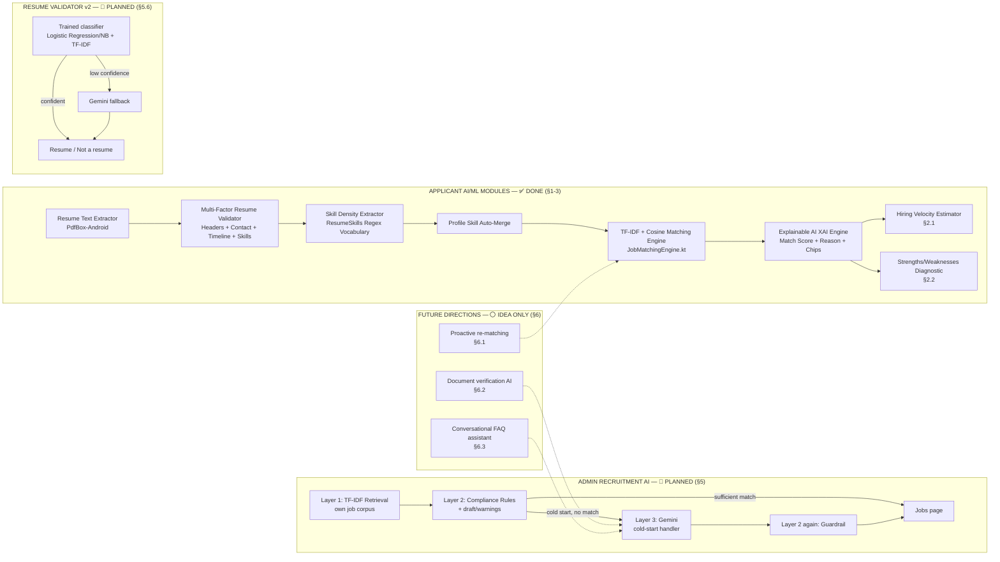
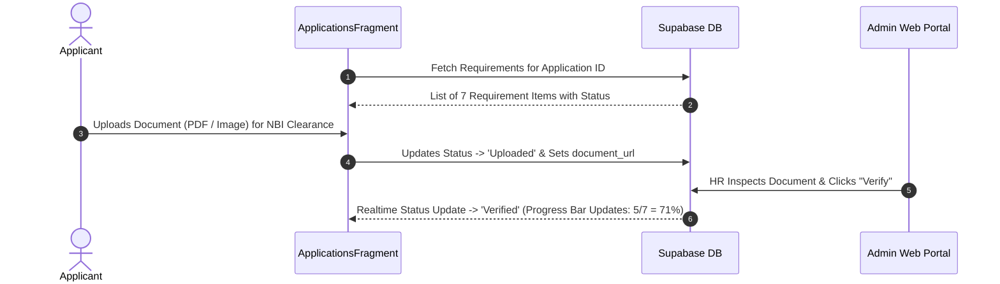

# MR.D.I.Y. Careers — Advanced AI/ML & Pre-Employment Planning Specification

This document provides a comprehensive engineering blueprint for advanced AI/ML features, pre-employment onboarding workflows, hiring velocity estimation, candidate strengths/weaknesses diagnostics, explainable AI ranking, and AI job description generation for the HR Admin portal.

---

## Architecture Overview

Status legend: ✅ done (Section 1-3) · 🔵 PLANNED, has phases (Section 5, 5.6) · ⚪ idea only, no code (Section 6.1-6.3) · ⚠️ superseded (Section 4)



---

## Section 1: Pre-Employment Steps & Onboarding Checklist Workflow

### 1.1 Objective
Provide an interactive pre-employment onboarding workflow for candidates who reach the "Shortlisted" or "Hired" stage, guiding them through required pre-employment documents and government compliance steps before day 1 of work.

### 1.2 Requirements Checklist
- SSS Number / E-1 Form
- PhilHealth Member Data Record (MDR)
- Pag-IBIG MID Number / Member Data Form
- NBI Clearance / Police Clearance
- Pre-Employment Medical Exam / Health Permit
- BIR Form 1902 / TIN
- Signed Employment Contract

### 1.3 Data Schema (Supabase PostgreSQL)
Table Name: `public.pre_employment_requirements`
- `id` (UUID, Primary Key, default `gen_random_uuid()`)
- `user_id` (TEXT, Foreign Key -> `profiles.user_id`)
- `application_id` (UUID, Foreign Key -> `applications.id`)
- `requirement_name` (TEXT, e.g., 'NBI Clearance')
- `status` (TEXT: 'Pending', 'Uploaded', 'Verified', 'Rejected')
- `document_url` (TEXT)
- `updated_at` (TIMESTAMPTZ, default `now()`)

### 1.4 Workflow Sequence


---

## Section 2: Hiring Velocity Estimator & Strengths/Weaknesses ML Diagnostic

### 2.1 Hiring Velocity Estimator Algorithm
Predicts estimated turnaround days from application submission to official job offer.

$$\text{Estimated Days} = \text{Base Timeline (7 Days)} + \Delta_{\text{Match}} + \Delta_{\text{Profile}} + \Delta_{\text{Docs}} + \Delta_{\text{Gaps}}$$

- **Base Hiring Timeline:** 7 Business Days
- **Score Adjustments ($\Delta$):**
  - Match Score $\ge 85\%$: $-2$ Days (High urgency priority hire)
  - Complete Profile & Uploaded Resume: $-1$ Day
  - Complete Pre-Employment Documents: $-1$ Day
  - Lacks core skills ($< 50\%$ match): $+3$ Days
  - Experience Level Mismatch: $+2$ Days
- **Output Format:** `"Estimated Hiring Velocity: 2 - 4 Business Days"`

### 2.2 Strengths and Weaknesses ML Diagnostic Engine
Class Name: `CandidateDiagnosticEngine.kt`

#### A. Strengths
- Core Skill Matches: Matches between candidate skills and job requirements.
- Experience Fit: Candidate years of experience vs required level.
- Geographic Fit: Lives within Metro Manila branch boundary (`LocationDistance.kt`).
- Example Outputs:
  - `[+]` *"Strong Cash Handling & POS expertise (3+ years)"*
  - `[+]` *"High TF-IDF similarity in Store Management & Inventory Auditing"*
  - `[+]` *"Location match: Pasig City (Branch Proximity ~4.2 km)"*

#### B. Weaknesses / Skill Gaps
- Missing Core Skills: Key requirements listed in job description missing from candidate profile.
- Missing Certifications: e.g., Forklift license, First Aid certification.
- Example Outputs:
  - `[-]` *"Lacks listed requirement: Forklift Operation Certification"*
  - `[-]` *"No prior experience listed in Visual Merchandising"*

---

## Section 3: Explainable AI (XAI) Ranking Explanation Engine

### 3.1 Objective
Provide transparent, human-readable explanations detailing WHY a candidate was ranked at a specific position and match percentage, eliminating black-box AI mistrust.

### 3.2 Mathematical Model (TF-IDF & Cosine Similarity)

**What TF-IDF actually means — not just the acronym, but what it really stands for:**

**TF-IDF** stands for **Term Frequency – Inverse Document Frequency**. It has two parts, each with its own job:

- **Term Frequency (TF)** — "how often this word appears IN ONE document." For example, if the word "cashier" appears 10 times in a 200-word resume, its TF is high there. **Intuition:** if a resume mentions a word often, it's likely important to that person.

- **Inverse Document Frequency (IDF)** — "how rare this word is ACROSS ALL documents" (across the whole collection/corpus — all job postings or resumes). This is the opposite: if a word appears in ALMOST ALL documents (e.g. "the," "and," "experience"), its IDF is **low** — it's just a common word, meaningless as a "distinguishing trait." But if it rarely appears (e.g. "forklift" or "cashiering"), its IDF is **high** — meaning it's an important word for telling this document apart from others. **Intuition:** a rare word = a better "fingerprint" for identifying a document.

- **TF-IDF = TF × IDF** — combines both: a word scores high if it **appears often in ONE document, BUT is rare across ALL the others.** This is how the system finds which words truly "represent" a resume or job posting, instead of just counting words.

**A concrete example:** in a resume, the word "the" might appear 20 times (high TF) but it also appears in ALL other resumes (low IDF) — so its final TF-IDF score stays low, it's not treated as an "important word." Meanwhile, the word "forklift" might appear only 2 times (lower TF than "the") but only a FEW resumes contain this word (high IDF) — so its final TF-IDF is higher, making it more "meaningful" for identifying that person's actual specialty.

Once each word's TF-IDF score is computed, the whole document (resume or job) is converted into a "vector" (a list of numbers, one number per word in the vocabulary) — this is where **Cosine Similarity** comes in, which measures how "aligned in direction" two vectors are (0% = no similarity, 100% = identical). This is used to determine how similar a resume is to a job posting, or how similar a new job title is to existing postings (Layer 1 of the JD Generator, §5).

**Mathematical representation:**

$$\text{TF}(t, d) = \frac{f_{t,d}}{\sum_{t' \in d} f_{t',d}}$$

$$\text{IDF}(t, D) = \ln\left( \frac{|D|}{1 + |\{d \in D : t \in d\}|} \right)$$

$$\text{TF-IDF}(t, d, D) = \text{TF}(t, d) \times \text{IDF}(t, D)$$

Cosine Similarity Equation:

$$\text{Cosine Similarity}(\vec{A}, \vec{B}) = \frac{\vec{A} \cdot \vec{B}}{\|\vec{A}\| \|\vec{B}\|} = \frac{\sum_{i=1}^{n} A_i B_i}{\sqrt{\sum_{i=1}^{n} A_i^2} \sqrt{\sum_{i=1}^{n} B_i^2}}$$

### 3.3 XAI Explanation Template Output
> *"Candidate [Name] is ranked at #[Rank] with a [Score]% Match for [Job Title]. This ranking is driven by a [Similarity]% text similarity in [Category] roles, matching [MatchedCount] out of [TotalReqs] primary job requirements ([SkillsList]). Candidate experience of [Years] years aligns with the [Level] requirement."*

---

## Section 4: AI Job Description Generator for Admin Web Portal — ⚠️ SUPERSEDED, see Section 5

This idea (template-based only, no ML) was **replaced by the Layered AI Job Description Generator in Section 5**, which has its own TF-IDF retrieval + rules as the core, with Gemini as the cold-start handler. Left here only as a record of the original proposal.

### 4.1 Objective
Assist HR Administrators when creating or editing job postings in the Admin Web Portal (`mrdiy-admin`) by automatically generating optimized, retail-ready job descriptions based on the specified job title.

### 4.2 UI & Functionality
- **UI Button:** `✨ Generate AI Description` button next to Description field in `mrdiy-admin/app/jobs/page.tsx`.
- **Input:** Job Title (e.g., *"Store Supervisor"*, *"Warehouse Crew"*, *"Cashier"*, *"HR Officer"*).
- **Template Output Structure:**
  - About the Role
  - Key Responsibilities
  - Requirements
  - Benefits

---

## Section 5: Layered AI Job Description Generator — PLANNED (2026-10-14)

This replaces the approach in Section 4 (template-based, no ML).

**Loose end resolved (2026-10-15):** we initially considered making this a trained classifier using the 24-category Kaggle resume dataset (HR, Sales, IT, Aviation, Advocate, Agriculture...). **That idea was dropped** — it fell out of scope, since most of the 24 categories have nothing to do with MR.DIY's actual positions (Cashier, Stock Clerk, Store Manager, etc.). The Resume Validator (§5.6) is the trained-model feature now, not the JD Generator.

### 5.1 Rule (capstone constraint)

- **"Just a plain AI API" is not allowed.** The study's title is *"A Mobile-Based Recruitment System Using Machine Learning For Mr. D.I.Y."* The title does not mention an API; it's only a suggestion. So the core must be **the system's own ML**, with the external AI API (Gemini) as an additional layer on top.
- **Gemini is not "just for polish" (revised 2026-10-15).** Earlier decision: Gemini = "optional, just smooths out the wording." But the user's point was correct: if everything is already in the database (existing job postings), what is AI's real contribution if it's only used in the common case? **Layer 1 (TF-IDF retrieval) only works if there's a similar existing posting.** When it's a new kind of job with no example yet in the database (cold start — e.g. the first time posting "IT Support Technician"), **Layer 1 finds nothing**, producing a weak or blank output. That's where calling Gemini becomes **mandatory** — no longer optional, because there's no other source of content. When there are 2+ good matching existing postings, Layer 1+2 alone is enough (no Gemini, fast, free).
- **Test (revised):** not "remove Gemini, it should still work" but rather "when there's a sufficiently similar existing posting (not cold-start), it should work without Gemini." Gemini itself cannot simply be removed from the whole system, but there's a clear condition for when it's actually needed.
- **No new training required.** Uses ML already in scope: TF-IDF + cosine similarity (fitted on MR.DIY's own job corpus) and the skill extraction vocabulary.

### 5.2 Layers

```
HR input: job title, category, level, branch, contract duration
        │
Layer 1 — OWN ML (core, works even offline)
        • TF-IDF + cosine (same engine as matching, lib/matching.ts)
          → finds the top-k most similar existing MR.DIY job
            postings in the `jobs` table
        • Builds a draft from their responsibilities/requirements
          (retrieval-based generation, not a copy of a single posting)
        • Skill extraction (ResumeSkills vocabulary) → suggested skills
        │
Layer 2 — OWN RULES (MR.DIY standard + compliance)
        • Complete sections: About the Role / Key Responsibilities /
          Requirements / Benefits
        • Mandatory benefits (SSS, PhilHealth, Pag-IBIG), contract duration
          if Contractual, branch/location
        • Flags banned wording (e.g. age limit — RA 10911, Anti-Age
          Discrimination in Employment Act)
        │
Layer 3 — Gemini (COLD-START HANDLER, mandatory when <2 similar postings)
        • Condition: only called when Layer 1 lacks enough similar
          postings (low similarity score) — when there are enough,
          it is not called, Layer 1+2 alone is used
        • Input: the draft from Layer 1+2 (grounded in job title/category/
          level/compliance rules), not just a blank job title
        • Generates new content when there's no similar posting; if a
          Layer 1 draft exists, only polishes it; not allowed to add
          new salary, benefits, or requirements
        • No key / no internet / error → Layer 2's base template becomes
          the final result (compliant but generic, not retrieval-based)
        │
Layer 2 again — GUARDRAIL on Gemini's output
        • Are the sections still complete? Any invented salary/benefits?
          Any banned wording? If it fails → the Layer 2 draft is returned instead
        │
Layer 4 — HR review and edit before publishing (a human always makes the final call)
```

### 5.3 Shown in the UI (Jobs page, admin)

- Button: **"✨ Generate description"** next to the Description field.
- After generating, HR sees:
  - the draft (editable),
  - **"Based on:"** a list of the existing postings it drew from + similarity % if there's a match (explainable, same concept as "Why this rank") — or **"No similar posting found — generated by Gemini"** if cold-start,
  - a clear label for what happened: **"Generated from existing postings"** (Layer 1+2 only) / **"Written by Gemini — no similar role yet"** (cold-start) / **"Polished by Gemini"** (similar posting exists, just polished),
  - Layer 2 warnings (e.g. "Age requirement detected — remove before publishing").

### 5.4 How to defend this in the panel

| Panel question | Answer |
|---|---|
| "Isn't that just an API?" | No. The core is our own TF-IDF + cosine over the MR.DIY job corpus — it works without Gemini in most cases (when there's a sufficiently similar existing posting). |
| "Where's the ML?" | Layer 1: TF-IDF (IDF learned from the job corpus) + cosine similarity retrieval + skill extraction. Same engine as the app's matching. |
| "Why is Gemini needed if everything's already in the database?" | Because Layer 1 relies on an EXISTING similar posting — it has nothing when it's a new kind of job. That's when Gemini becomes mandatory, because there's no other source of content. Once there's a sufficient match, it's not used. |
| "What if Gemini gets it wrong?" | There's a guardrail (Layer 2 again) and HR review (Layer 4) before publishing. |
| "Is it explainable?" | Yes. It shows which postings it drew from, how similar they are, or whether it was cold-start and actually came from Gemini. |

### 5.5 Phases

| Phase | What to do | Checkpoint |
|---|---|---|
| 1 | Layer 1 + 2 (API route in `mrdiy-admin`, no Gemini) | ✅ **Done (2026-10-15)** — lint + build + `curl` test against the real database. 4 bugs found and fixed during testing (details in `CapstoneGuidePaper/jdGenerator.md`) — wrong similarity threshold, category/level overwhelming the title, two age-limit phrasings that weren't caught. |
| 2 | UI button + "Based on" + warnings on the Jobs page | ✅ **Code done (2026-10-15)** — lint clean, build successful. Not yet verified in the browser (no browser tool in this session), still needs to be clicked through manually. |
| 3 | Layer 3 Gemini (cold-start handler) + guardrail | ✅ **Code done (2026-10-15), with a real key too.** A real `GEMINI_API_KEY` now exists — 3 bugs found and fixed during testing (outdated model name, overly strict prompt, no timeout). Also added: retry-on-503, and variety in the generic fallback (which had its own bug — biased random pick, fixed). We haven't yet caught one fully successful real Gemini generation due to persistent "high demand" on the free tier, but every other part has been fully verified. Details in `CapstoneGuidePaper/jdGenerator.md`. |

### 5.6 Resume Validator — TRAINED MODEL as primary, Gemini as fallback (decision 2026-10-14)

This is the best-fit candidate for training, already in scope: the **Resume Validator** (`ResumeRepository.kt`), currently rule-based only ("is this a resume or not," 4 hand-tuned-threshold signals).

**Architecture:**

```
Uploaded document (text from extraction)
        │
PRIMARY — Own TRAINED MODEL (offline, fast, free)
        • Binary classifier (Logistic Regression or Naive Bayes + TF-IDF)
        • Trained in a notebook (Python/Colab) — resume dataset as positive
          examples (any real resume counts, category doesn't matter —
          the only question is "is this a resume," not "what kind of resume"),
          non-resume documents (recipes, invoices, articles) as negative
        • Weights/vocabulary exported as JSON, and the PREDICTION
          (inference) itself is written in TypeScript — no Python server
          runs in production
        │
FALLBACK — Gemini API
        • Called ONLY when the own model's confidence is low
          (e.g. <70%) or when local inference errors out
        • Not the first thing tried — second line only
        │
Result: "Resume" or "Not a resume," with a confidence %, and a label for
        where the decision came from ("Own model" or "Gemini fallback")
```

**Why there's no live Python in production:** Python is only used for training (offline, Colab/notebook) — it doesn't run in the real system. After training, the simple linear model (weights + TF-IDF vocabulary) is easily translated into a TypeScript function — no need to deploy, host, or maintain a separate Python microservice. Less to maintain, simpler architecture.

**To be compared:** old (rules) vs new (trained model) on the same test set — accuracy, precision, recall, F1. This is a separate decision from the JD Generator.

**Sequence (revised 2026-10-15 — files/libs prepared, but the dataset itself comes last, after research):**

| Step | What to do | Status |
|---|---|---|
| A | Prepare the training scaffold: folder, `requirements.txt`, script skeleton with a data placeholder | ✅ Done — `CapstoneGuidePaper/resume-validator-training/` (`requirements.txt`, `train_resume_validator.py`), verified: `pip install` + script run with no data, empty-data guard worked. **Explanation of each Python library** (what each is for, and why not PyTorch/TensorFlow): `CapstoneGuidePaper/resume-validator-training/README.md`. |
| B | Research and curate the dataset (checklist below — dedupe, balance, etc.) | ✅ **Done (2026-10-15).** Positive (resume): a Hugging Face mirror of the Kaggle "Resume Dataset" (LiveCareer), `Shawn0069/resume_classification_kaggle` (1,986 real resumes after removing duplicates/junk). Negative (not a resume): `fancyzhx/ag_news` (120,000 news snippets, clearly not resumes — serving the same role as "recipes/invoices/articles" in the original plan). Two public datasets, no account/API key needed — downloaded via Hugging Face's `datasets-server` API (direct parquet links). |
| C | Seed the actual dataset file (`dataset.csv`) | ✅ **Done.** `prepare_dataset.py` — sampled 500 resumes + 500 news articles (balanced), placed into `incoming/batch_001.csv`, passed `check_new_seed_data.py` (no warnings), manually moved to `approved/dataset.csv`. **1,000 rows, 500/500 balanced.** |
| D | Run the script: clean → split → train 3 models → compare → export the best one | ✅ **Done, real results.** F1: Logistic Regression 0.995, Naive Bayes 0.990, Linear SVM 1.000. Exported Logistic Regression (`resume_validator_weights.json`, 5,000-word vocabulary) — chosen because it's the only "linear model" that can be exported as a simple weights+vocabulary JSON for TypeScript inference (§5.6), even though SVM scored higher on F1. **Bug found and fixed:** `numpy.int64` in the vocabulary dict can't be JSON-serialized directly — cast to plain Python `int` before exporting. |

**Data-poisoning safeguards — code done, not just a warning (2026-10-15)**

In addition to the checklist below, this is a **real safeguard** built into the workflow itself, not just a reminder:

- **`incoming/` vs `approved/` staging folders** — the training script reads ONLY from `approved/dataset.csv`, never directly from `incoming/`. No new data is simply "trusted."
- **`check_new_seed_data.py`** — run this against every new batch BEFORE moving it to `approved/`. It checks: (1) format/missing columns, (2) labels that aren't 0/1, (3) text that's too short (<50 chars), (4) duplicates within the batch, (5) duplicates/near-duplicates against the ALREADY-APPROVED dataset (train/test leakage risk), (6) a sudden shift in class ratio vs the existing dataset. Nothing moves to `approved/` automatically — a human still makes the final call, even if every check passes.
- **Evaluation gate on export** — `export_logistic_regression()` **refuses to export** if the new model's F1 is lower than the last exported version — a better model can never be silently replaced by a worse one, even by accident.
- **Verified:** tested `check_new_seed_data.py` against deliberately broken sample data (wrong label, duplicate, too short) — correctly caught each one, correct exit code.

**Checklist — things to avoid in training data (decision 2026-10-15)**

Before training, check the dataset against this list first — this matters because **there's no automatic signal that seeded data is bad**; only evaluation (F1/accuracy on the test set) will reveal it, so these problems need to be avoided BEFORE training:

1. **Duplicate/near-identical examples** — most dangerous if a copy ends up in both the train AND test set ("data leakage"): accuracy looks high but is fake, not genuinely learned. Remove duplicates before splitting.
2. **Class imbalance** — if the count of positive (resume) and negative (not-resume) examples is far apart, the model will just learn to always answer the majority class. Keep the counts close, or look at precision/recall per class, not just overall accuracy.
3. **Negative examples that are too easy** — if the "not a resume" examples are too obvious (e.g. random articles), the model will just learn a shortcut instead of truly understanding. Include hard/close negative examples too.
4. **Mislabeled data (label noise)** — spot-check a sample of the dataset before using it, especially if it's a scraped/third-party source.
5. **Distribution mismatch — specific to us** — the Kaggle dataset is English-only (LiveCareer/US), but our real applicants may write in **Taglish or heavily-localized English**. Some real Taglish/Filipino resumes need to be added to the TEST set (even a small number) to measure whether it still works for real users, not just on a purely English dataset.

### 5.7 Rules that ALL AI features must follow (whether Gemini or a trained model) — decision 2026-10-14

**A. Scoped/guarded prompt — won't answer outside its scope.**
- Every call to Gemini has a strict system prompt that limits it only to its task (e.g. "job description generation for MR.DIY retail roles ONLY" or "resume classification ONLY") — if someone tries to ask something else (general chat, other topics), it refuses or falls back to a default unrelated response.
- This is the answer for the panel if asked: "This isn't a general-purpose chatbot — every AI call has a strict boundary."

**B. Traceable sources — applicants/HR need transparency.**
- No AI output is allowed to be a "black box." Every result must have a **traceable basis within the system itself** — not necessarily a literal external link, but a concrete reference:
  - JD Generator → "Based on: [job postings used] + similarity %" (§5.3)
  - Matching/ranking → "Why this rank" with a keyword breakdown (already in the system)
  - Resume Validator → which signals/words triggered the decision, and whether the own model or the Gemini fallback produced the result
- This is the same spirit as the Explainable AI we already have — just extended as **a rule for every future AI feature**, not only matching.

### 5.8 Gemini's role across the system's AI — not just for the FAQ (decision 2026-10-15)

Gemini has one consistent role across **all** AI features, not just the conversational assistant (§6.3): **it handles the cases the system's own ML/database can't** — it's not a general-purpose generator, but always fills a specific "gap."

| Feature | Own ML/data (tried first) | When Gemini fills the "gap" |
|---|---|---|
| **JD Generator** (§5) | TF-IDF retrieval over existing MR.DIY job postings | **Cold start** — no/few similar postings in the database (a new kind of job) |
| **Resume Validator** (§5.6) | Trained binary classifier (Logistic Regression/Naive Bayes + TF-IDF) | **Low confidence** — the own model isn't sure whether it's a resume or not |
| **Document verification** (§6.2, not yet built) | — (no current automated check) | **The whole task** — no own vision/OCR model, so Gemini Vision itself does the document reading, always with a guardrail (format check, expiry parsing) |
| **FAQ assistant** (§6.3, not yet built) | Existing job/requirement data as context | **Natural-language questions** — not a structured query, so a conversational layer over the structured data is needed |

**The pattern:** database/own ML first (fast, free, explainable) → Gemini only when there's a real gap it can't cover — cold start, low confidence, no existing automated check, or natural-language input. This isn't "AI just so AI runs" — there's a specific reason it runs in each case, and the reason is always documented (§5.7B, traceable sources).

---

## Section 6: Additional directions for expanding the AI — PLANNED (2026-10-14)

Options discussed for further expanding the system's AI, beyond the JD Generator (§5) and Resume Validator (§5.6). No code yet; listed only as options.

**6.1 Proactive re-matching (easiest, safest — recommended first)**

- When a new job posting is created, scan PAST applicants who were close to the match threshold but weren't hired (not due to lacking skills, but due to branch/timing) — send them a notification: "A new Cashier opening is available in Cainta, might suit you."
- **No new model.** Just uses the existing TF-IDF + cosine engine (`lib/matching.ts`) in a different direction — job-to-past-applicants instead of resume-to-jobs. A pure "trigger/notify" layer on top of the ML that already exists.

**6.2 Document verification AI (biggest addition, new dependency)**

- Currently, HR verification of uploaded NBI Clearance/SSS/Valid ID is still manual (just looking at the photo). Using vision/OCR AI (Gemini Vision), the document's content would be read automatically — checking if the name matches the profile, if it's expired, if the details are complete.
- A new modality (images, not just text) — real time savings for HR, but a new external dependency (vision API) that must follow the same rules in §5.7 (scoped prompt + traceable basis, e.g. "this is where the expiry date was read from").

**6.3 Conversational assistant for applicant FAQs**

- A chatbot that answers questions about a job posting or the application process, using existing job/requirement data as context (grounded, not free-form chat — same rule as §5.7A).
- An extension of the Gemini layer, but for the applicant side this time instead of the admin side.

**Suggested order:** 6.1 first (no new dependency, quick to demo), then 6.2 if a "weightier" AI feature is wanted for the defense, 6.3 if there's still time.
