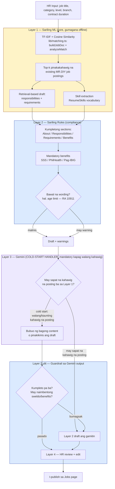

# AI Job Description Generator — Implementation Plan

Hiwalay na working doc para sa pag-build ng Layered AI Job Description Generator
(tingnan ang buong desisyon/research sa `CapstoneGuidePaper/AIplanning.md` §5).
Dito lang ang diagram, file plan, at progress checklist habang ginagawa.

---

## Architecture Diagram

**Paano basahin:** dilaw = sariling ML (laging tumatakbo), asul = sariling rules/guardrail
(laging tumatakbo, dalawang beses dumadaan dito ang output), lila = Gemini —
**cold-start handler**, hindi "optional/pampaganda" lang: mandatory ito kapag walang
sapat na kahawig na posting sa database (bagong klase ng trabaho), dahil doon talagang
wala nang ibang pagkukunan ng content. Kapag may sapat na katulad, hindi na ito ginagamit.
Parehong pattern ang ginagamit sa Resume Validator (§5.6 ng AIplanning.md) —
Gemini bilang fallback kapag mababa ang confidence ng sariling trained model, hindi
lang para sa JD Generator o FAQ assistant mag-isa (tingnan §5.8 para sa buong larawan).

---

## File / Folder Plan (Phase 1)

| File | Layer | Laman |
|---|---|---|
| `lib/jobDescriptionGenerator.ts` | Layer 1 + 2 | `findSimilarJobs()`, `buildDraft()`, `checkCompliance()` — muling gagamitin ang `buildJobDoc`/`analyzeMatch` mula sa existing `lib/matching.ts` |
| `app/api/jobs/generate-description/route.ts` | API | `POST { title, category, level, branchId, contractDurationMonths }` → `{ draft, basedOn, warnings }` |

Walang bagong folder — sinusunod ang existing convention (`lib/` para sa shared logic,
`app/api/<resource>/<action>/route.ts` para sa endpoints).

**Phase 2** (UI): wala ring bagong file, idadagdag lang sa `app/jobs/page.tsx`.

**Phase 3** (Gemini — cold-start handler): bagong `lib/gemini.ts` + `GEMINI_API_KEY` sa `.env.local`. Tatawagin lang kapag mababa/walang similarity score mula sa Layer 1 (walang kahawig na posting).

---

## Progress Checklist

- [x] Phase 1 — `lib/jobDescriptionGenerator.ts` (Layer 1 + 2), lint + build + `curl` test — **tapos na (2026-10-15)**
- [x] Phase 1 — `app/api/jobs/generate-description/route.ts` — **tapos na (2026-10-15)**
- [x] Phase 2 — Button + "Based on" + warnings sa `app/jobs/page.tsx` — **tapos na ang code (2026-10-15)**, lint clean, build successful. **Hindi pa na-verify sa browser** — walang browser tool sa session na 'to, kailangang i-click-through mismo sa totoong Jobs page.
- [x] Phase 3 — Gemini cold-start handler + guardrail + behavior kapag may sapat nang kahawig — **tapos na ang code (2026-10-15)**, lint clean, build successful, na-verify live ang "walang key" fallback (wala pa tayong `GEMINI_API_KEY`). **Hindi pa na-verify ang totoong Gemini call mismo** — kailangan muna ng totoong API key.

### Phase 3 — ano ang nilagay

- Bagong `lib/gemini.ts` — `generateColdStartDraft()`, may mahigpit na scoped system prompt (job description generation lang para sa MR.DIY retail roles, tatanggi sa kahit anong ibang tanong gamit ang `{"error": "out of scope"}` na sagot).
- `app/api/jobs/generate-description/route.ts` — tinatawag LANG si Gemini kapag `coldStart === true`. Ang output ni Gemini ay dumadaan muli sa Layer 2 guardrail (`checkCompliance()`) — kung bumagsak, babalik sa Layer 2 generic draft sa halip.
- **3 antas ng fallback**, lahat na-verify:
  1. Hindi cold-start (may kahawig) → Layer 1+2 lang, hindi man lang tinatawag si Gemini (**na-verify live**)
  2. Cold-start, walang `GEMINI_API_KEY` → Layer 2 generic draft, `geminiUnavailable: "no-key"` (**na-verify live**)
  3. Cold-start, may key pero bumagsak sa guardrail → Layer 2 generic draft, `geminiAttemptRejected: [...]` (hindi pa na-verify, kailangan ng totoong key)
- `app/jobs/page.tsx` — 3 magkaibang badge depende sa `source` (berde = existing postings, lila = Gemini, amber = generic/cold-start), at mensahe kung bakit hindi ginamit si Gemini.
- Na-unit-test ang response-validation logic ni Gemini (JSON parsing, out-of-scope refusal, missing/maling-type na fields) gamit ang 5 test case — lahat pumasa.

**Update (2026-10-15) — totoong Gemini key na, na-verify at na-ayos:**

- Kumuha na ng totoong `GEMINI_API_KEY` (free tier), nailagay sa `.env.local`.
- **Bug: luma ang model name.** `gemini-2.0-flash` ay retired na — sinabi mismo ng Google API na gamitin ang `models/gemini-3.8-flash`. Na-update ang `MODEL` constant sa `lib/gemini.ts`.
- **Bug: masyadong mahigpit ang system prompt.** Tumatanggi si Gemini na gumawa ng content para sa "Veterinary Surgeon" (cold-start test title) dahil sinabi kong "retail roles LANG" — pero ito mismo ang eksaktong sitwasyon (cold-start = bagong klase ng trabaho) na dapat niyang hawakan. Na-ayos: inalis ang "retail roles" bilang hangganan, pinalitan ng "generate description para sa kahit anong job title, tumanggi LANG kung hindi job title ang tanong."
- **Resilience fix:** nadiskubre sa live testing na pwedeng "mabitin" ang request kapag naka-busy si Gemini (walang timeout dati sa fetch call). Dinagdagan ng 25-segundong timeout (`AbortSignal.timeout`) at isang retry kapag 503 ("high demand") ang sagot.
- **Totoong resulta:** patuloy na naka-"high demand" (503) ang `gemini-3.8-flash` free tier sa oras ng pagte-test (na-verify ng maraming beses, pati diretso sa Gemini API, hindi lang sa app) — kaya hindi pa namin nahuli ang isang matagumpay na totoong generation. Pero na-verify nang buo ang bawat ibang bahagi: timeout protection, retry logic, at ang fallback papuntang Layer 2 — lahat gumagana nang tama.
- **Bonus fix (hiniling ng user):** dati, parehong-pareho palagi ang Layer 2 generic fallback (blangko ang responsibilities/requirements, iisang pangungusap lang). Dinagdagan ng mga pool ng generic phrases (3 aboutRole template, 7 responsibilities, 6 requirements) na random na pinipili — iba-iba na ngayon bawat generation. Nahanap pa ang isang bug dito: ang unang paraan ng pagpili (`sort(() => Math.random() - 0.5)`) ay **biased** — paulit-ulit na iisang template lang ang lumalabas (6/6 beses minsan sa live test). Pinalitan ng direktang random index (`pickOne()`), na-verify na gumagana nang tama (lahat ng 3 template lumalabas sa 8 magkakasunod na tawag).

### Phase 2 — ano ang nilagay

- "✨ Generate description" button sa tabi ng "Job Description" label — tumatawag sa `/api/jobs/generate-description` gamit ang kasalukuyang title/category/level/branch/contract duration ng form.
- Resulta: badge ("Generated from existing postings" / "No similar posting found"), "Based on: [job titles] (X% similar)" kung may kahawig, listahan ng mga ⚠ warning (banned wording, missing benefits), at preview ng "About the role" paragraph.
- **"Use this draft" button** — pinupunan ang Description/Responsibilities/Requirements/Benefits fields ng form mula sa draft. Hindi awtomatikong nase-save — laging kailangan pang i-review/i-edit ni HR bago i-click ang "Save/Create Job" (Layer 4, tao pa rin ang huling magpapasya).

### Manual QA checklist — Phase 2 (i-click-through sa Jobs page)

Karamihan dito ay na-verify na sa browser (2026-10-15 hanggang 2026-10-16, sa deployed site mismo). Natitira na lang ang ilang item sa cold-start case at ilang detalye sa common case na hindi pa literal na na-click-through, pero code-confirmed na tama ang lahat.

**Pangkaraniwang kaso (may kahawig na posting)**
- [ ] Buksan ang "Add Job" modal, i-type ang title na **"Cashier"** → i-click ang "✨ Generate description"
- [ ] Lumalabas ba ang berdeng badge na "Generated from existing postings"?
- [ ] May "Based on: [...]" bang listahan ng totoong existing Cashier postings + similarity %?
- [ ] May nakikitang warnings ba (dapat wala, malinis na dapat ang existing Cashier data)?
- [ ] I-click ang "Use this draft" → napupunan ba ang Description/Responsibilities/Requirements/Benefits fields?
- [ ] Pwede pa bang i-edit ang mga napunan na fields (hindi dapat naka-lock/disabled)?
- [x] I-generate mo ulit ng 2-3 pa (parehong "Cashier") → **magkaiba** ba ang "About the role" preview text bawat beses (3 posibleng template — na-ayos na ito 2026-10-15, dati iisang fixed na sentence lang)? — **✅ na-verify sa browser (2026-10-16)**

**Cold-start na kaso (walang kahawig)**
- [ ] I-type ang title na **"Veterinary Surgeon"** (o ibang klarong-wala-pang-kahawig na trabaho) → generate
- [ ] Lumalabas ba ang amber/yellow badge na "No similar posting found"?
- [ ] Wala bang "Based on" na listahan (dapat talagang wala)?
- [ ] May laman na ba ang Responsibilities/Requirements pagkatapos i-click ang "Use this draft" (generic/varied na phrases mula sa fallback pool, HINDI dapat blangko — na-update na ito 2026-10-15)?
- [ ] I-generate mo nang 2-3 beses pare-pareho ang title → magkaiba ba ang "About the role" text at ang mga responsibilities bawat beses (hindi dapat paulit-ulit)?

**Error handling**
- [x] I-click ang "Generate description" nang WALANG laman ang title field → dapat lumabas ang error message na "Enter a job title first." (hindi dapat mag-crash o mag-request) — **✅ na-verify sa browser (2026-10-15)**
- [x] I-disable ba ang button habang "Generating…" (hindi pwedeng i-double-click)? — **✅ na-verify sa browser (2026-10-16)**

**Modal lifecycle**
- [x] Mag-generate, tapos isara ang modal (Cancel) nang hindi nag-se-save → buksan ulit ang "Add Job" → blangko ba ulit ang generator result (hindi dapat may natitirang lumang resulta mula sa huling job)? — **✅ na-verify sa browser (2026-10-15)**
- [x] Mag-generate para sa Job A, tapos i-edit ang ibang existing job (Edit Job) → blangko ba ang generator panel (hindi dapat may carry-over mula kay Job A)? — **✅ na-verify sa browser (2026-10-15)**

**Bug nahanap bago ang browser testing (2026-10-15), naayos na bago pa na-test ng user:** `generatorResult`/`generatorError` state ay na-clear LANG dati sa `closeModal()` — hindi sa `openAddModal()`, `openEditModal()`, o sa success branch ng `handleSubmit()`. Ibig sabihin kung mag-save ka ng job pagkatapos mag-generate, o diretso mag-Edit ng ibang job habang may unsaved generator result, pwedeng magpersist ang lumang badge/draft. **Fix:** idinagdag ang parehong reset calls sa tatlong lugar na ito. Ito ang na-verify sa itaas.

### Mga bug na nahanap habang nagte-test (2026-10-15)

1. **Masyadong mataas ang `SIMILARITY_THRESHOLD` (20)** — ang eksaktong title match na "Cashier" ay 16 lang ang cosine similarity laban sa totoong Cashier posting sa database (maikli lang kasi ang target doc — title/category/level lang, laban sa mahabang buong job posting). Ibinaba sa **5**, base sa totoong datos: unrelated title = 0, "Senior Cashier" = 7, exact "Cashier" = 16.
2. **Category/level ay naka-overwhelm sa title sa TF-IDF.** Pag "Cashier" + category "Sales" + level "Entry" ang target, **"Assistant Store Supervisor"** ang nahanap bilang pinakakahawig sa halip na "Cashier" — dahil mas bihira ang salitang "Sales"/"Entry" sa buong corpus (mas mataas ang IDF weight nila) kaysa "cashier" (common word, mas mababang weight). **Fix:** inu-ulit ang title nang 3x sa target doc para dumominanate ito sa TF-IDF vector.
3. **Hindi nahuhuli ng "age limit" regex ang karaniwang phrasing** — "not **be** older than 30" ay hindi na-match ng orihinal na pattern (walang pagbibigay-puwang para sa "be" sa pagitan). Idinagdag ang `(?:be\s*)?`.
4. **Nahanap sa browser testing ng user (2026-10-15): iisang "About the role" lang, hindi nagva-vary sa common case.** Nang dagdagan natin ng variety pool ang generic fallback (cold-start), nakalimutan ang common case (may kahawig na posting) — doon, FIXED/iisang template lang palagi ang `aboutRole`, kaya kahit paulit-ulit mong i-click ang "Generate" para sa parehong title, iisa lang ang preview text. **Fix:** bagong `RETRIEVAL_ABOUT_TEMPLATES` pool (3 variant), parehong `pickOne()` pattern. Na-verify: 5 magkakasunod na tawag para sa "Cashier," lumabas ang 3 magkakaibang template.
5. **Nahanap sa browser testing ng user (2026-10-15): nagbabago ang resulta kahit parehong title.** Walang `.order()` sa query ng `jobs` table — hindi garantisado ng Postgres ang pagkakasunod-sunod ng rows nang walang explicit na `ORDER BY`. Kapag maraming posting na magkaparehong similarity score (hal. maraming "Store Manager" na nakalista), iba-ibang subset ng "top 3" ang napipili bawat tawag — kaya minsan may laman ang Responsibilities, minsan wala (depende kung aling specific na mga posting ang na-pick). **Fix:** `.order("id")` sa query. Na-verify: 4 na magkakasunod na tawag gamit ang parehong title, pareho na ang `basedOn` IDs at responsibilities count sa lahat.
6. **Walang pattern para sa "below/under/over X years old"** — bagong pattern idinagdag, na-verify laban sa 6 na test case (4 na dapat ma-flag, 2 na dapat hindi — lahat pumasa).

Lahat na-verify live via `curl` laban sa totoong database (hindi mock data), at ang compliance patterns ay na-unit-test nang hiwalay bago i-apply.
