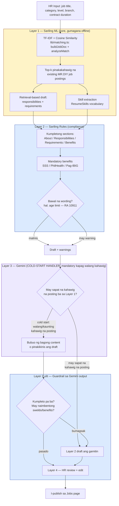

# AI Job Description Generator — Implementation Plan

Hiwalay na working doc para sa pag-build ng Layered AI Job Description Generator
(tingnan ang buong desisyon/research sa `CapstoneGuidePaper/AIplanning.md` §5).
Dito lang ang diagram, file plan, at progress checklist habang ginagawa.

---

## Architecture Diagram

**Paano basahin:** dilaw = sariling ML (laging tumatakbo), asul = sariling rules/guardrail
(laging tumatakbo, dalawang beses dumadaan dito ang output), lila = Gemini —
**cold-start handler**, hindi "optional/pampaganda" lang: mandatory ito kapag walang
sapat na kahawig na posting sa database (bagong klase ng trabaho), dahil doon talagang
wala nang ibang pagkukunan ng content. Kapag may sapat na katulad, hindi na ito ginagamit.
Parehong pattern ang ginagamit sa Resume Validator (§5.6 ng AIplanning.md) —
Gemini bilang fallback kapag mababa ang confidence ng sariling trained model, hindi
lang para sa JD Generator o FAQ assistant mag-isa (tingnan §5.8 para sa buong larawan).

---

## File / Folder Plan (Phase 1)

| File | Layer | Laman |
|---|---|---|
| `lib/jobDescriptionGenerator.ts` | Layer 1 + 2 | `findSimilarJobs()`, `buildDraft()`, `checkCompliance()` — muling gagamitin ang `buildJobDoc`/`analyzeMatch` mula sa existing `lib/matching.ts` |
| `app/api/jobs/generate-description/route.ts` | API | `POST { title, category, level, branchId, contractDurationMonths }` → `{ draft, basedOn, warnings }` |

Walang bagong folder — sinusunod ang existing convention (`lib/` para sa shared logic,
`app/api/<resource>/<action>/route.ts` para sa endpoints).

**Phase 2** (UI): wala ring bagong file, idadagdag lang sa `app/jobs/page.tsx`.

**Phase 3** (Gemini — cold-start handler): bagong `lib/gemini.ts` + `GEMINI_API_KEY` sa `.env.local`. Tatawagin lang kapag mababa/walang similarity score mula sa Layer 1 (walang kahawig na posting).

---

## Progress Checklist

- [ ] Phase 1 — `lib/jobDescriptionGenerator.ts` (Layer 1 + 2), lint + build + `curl` test
- [ ] Phase 1 — `app/api/jobs/generate-description/route.ts`
- [ ] Phase 2 — Button + "Based on" + warnings sa `app/jobs/page.tsx`
- [ ] Phase 3 — Gemini cold-start handler + guardrail + behavior kapag may sapat nang kahawig
